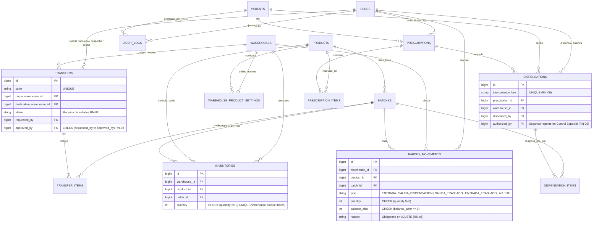
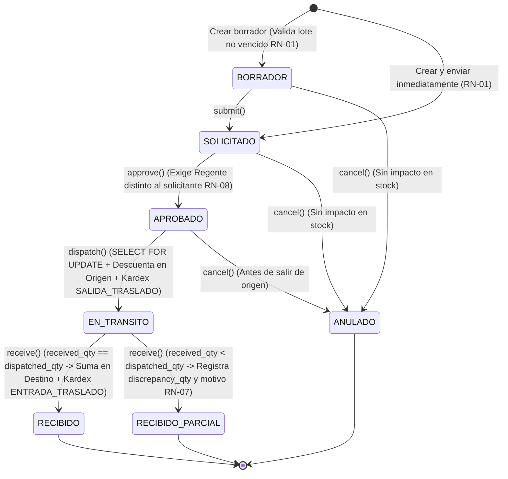

# FARTMAR IPS — Sistema Clínico de Inventario Farmacéutico, Dispensación FEFO y Traslados

Plataforma full-stack para la gestión de inventario hospitalario por lote, dispensación bajo algoritmo **FEFO (First Expired, First Out)** segura ante concurrencia, máquina de estados para traslados entre bodegas con segregación de funciones, kardex contable inmutable y asistente de inventario con Inteligencia Artificial provisto de guardrails de seguridad.

---

## Tabla de Contenidos
1. [Stack Tecnológico y Arquitectura](#1-stack-tecnológico-y-arquitectura)
2. [Diagrama Entidad-Relación (ERD)](#2-diagrama-entidad-relación-erd)
3. [Diagrama de Máquina de Estados de Traslados (RN-07 y RN-08)](#3-diagrama-de-máquina-de-estados-de-traslados-rn-07-y-rn-08)
4. [Variables de Entorno (.env)](#4-variables-de-entorno-env)
5. [Instalación y Ejecución (Docker y Local)](#5-instalación-y-ejecución-docker-y-local)
6. [Usuarios Sintéticos y Matriz de Permisos por Rol](#6-usuarios-sintéticos-y-matriz-de-permisos-por-rol)
7. [Documentación de Endpoints API REST](#7-documentación-de-endpoints-api-rest)
8. [Arquitectura del Asistente IA y Guardrails de Seguridad (Parte C)](#8-arquitectura-del-asistente-ia-y-guardrails-de-seguridad-parte-c)
9. [Suite de Pruebas, Cobertura, Concurrencia e Idempotencia](#9-suite-de-pruebas-cobertura-concurrencia-e-idempotencia)

---

## 1. Stack Tecnológico y Arquitectura

* **Base de Datos:** PostgreSQL 16 (con restricciones `CHECK` nativas, bloqueo pesimista `SELECT ... FOR UPDATE` y `TRIGGER` en `plpgsql` para inmutabilidad del Kardex).
* **Backend API:** PHP 8.3 + Laravel 13 + Laravel Sanctum. Lógica de dominio desacoplada en 5 servicios (`DispensationService`, `TransferService`, `KardexService`, `InventoryAlertService`, `AiInventoryAssistantService`).
* **Frontend SPA:** React 19 + TypeScript + Vite con cliente HTTP tipado y manejo de `X-Correlation-ID`.
* **DevOps y Calidad:** Docker Compose (imágenes multi-stage con usuarios no-root `www-data` y `nginx`), Laravel Pint, Larastan (PHPStan), ESLint y GitHub Actions CI.

---

## 2. Diagrama Entidad-Relación (ERD)



---

## 3. Diagrama de Máquina de Estados de Traslados (RN-07 y RN-08)



---

## 4. Variables de Entorno (`.env`)

El archivo `backend/.env.example` contiene todas las variables necesarias sin exponer secretos reales:

| Variable | Valor por Defecto | Propósito |
| :--- | :--- | :--- |
| `DB_CONNECTION` | `pgsql` | Motor relacional PostgreSQL 16. |
| `DB_HOST` | `db` (Docker) / `127.0.0.1` (Local) | Host del servidor de base de datos. |
| `DB_PORT` | `5432` | Puerto de PostgreSQL. |
| `DB_DATABASE` | `fartmar` | Nombre de la base de datos. |
| `DB_USERNAME` | `fartmar_user` | Usuario de conexión a PostgreSQL. |
| `DB_PASSWORD` | `fartmar_secret` | Contraseña de base de datos para entorno de desarrollo/pruebas. |
| `AI_PROVIDER` | `mock` | Proveedor de IA: `mock` (determinista sin API key) u `openai`. |
| `AI_API_KEY` | *(vacío)* | Llave de API opcional si se activa `AI_PROVIDER=openai`. |
| `AI_MODEL` | `gpt-4o-mini` | Modelo LLM a invocar cuando se usa proveedor externo. |
| `AI_BASE_URL` | `https://api.openai.com/v1` | Endpoint compatible con OpenAI / Ollama. |

---

## 5. Instalación y Ejecución (Docker y Local)

### Opción A: Entorno Completo Dockerizado (Recomendado)
Construye y levanta PostgreSQL 16, Backend API (ejecutando migraciones y seeders automáticamente) y Frontend SPA:
```bash
docker compose up -d --build
```
* **Frontend React SPA:** `http://localhost:5173`
* **API Healthcheck:** `http://localhost:8000/api/health`
* **Verificar estado de contenedores:** `docker compose ps`

### Opción B: Ejecución Híbrida para Desarrollo Local
```bash
# 1. Encender PostgreSQL 16 en Docker
docker compose up -d db

# 2. Backend Laravel (Terminal 1)
cd backend
cp .env.example .env
# Nota: En desarrollo local fuera de Docker, usar DB_HOST=127.0.0.1 en backend/.env
composer install
php artisan key:generate
php artisan migrate:fresh --seed
php artisan serve

# 3. Frontend React + TypeScript (Terminal 2)
cd frontend
npm install --legacy-peer-deps
npm run dev
```

---

## 6. Usuarios Sintéticos y Matriz de Permisos por Rol

Todos los usuarios semilla tienen la contraseña: **`password123`**

| Rol | Correo Electrónico | Permisos y Reglas Asociadas |
| :--- | :--- | :--- |
| `auxiliar_farmacia` | `auxiliar@fartmar.test` | Consulta existencias, dispensa medicamentos (con firma de regente si es control especial), solicita, despacha y recibe traslados. **No** puede aprobar traslados ni hacer ajustes de Kardex. |
| `regente_farmacia` (1°) | `regente@fartmar.test` | Dispensa, realiza ajustes manuales de inventario con motivo obligatorio (**RN-06**), solicita y aprueba traslados de otros usuarios (**RN-08**). |
| `regente_farmacia` (2°) | `regente2@fartmar.test` | Segundo regente para autorizar dispensación de medicamentos de control especial (**Morfina - RN-05**) y aprobar traslados creados por el Regente 1 (**RN-08**). |
| `auditor` | `auditor@fartmar.test` | Acceso de solo lectura a prescripciones, dispensaciones y bitácora `audit_logs`. Recibe todos los datos de pacientes **enmascarados** (`J*** P****`, `******3456`, `****-**-**`) (**RN-10**). |
| `medico` | `medico@fartmar.test` | Emisor de las prescripciones médicas sintéticas vigentes. |
| `admin` | `admin@fartmar.test` | Supervisión general y acceso a la bitácora de auditoría. |

---

## 7. Documentación de Endpoints API REST

Todas las peticiones y respuestas incluyen la cabecera de trazabilidad **`X-Correlation-ID`**. Las rutas protegidas requieren cabecera `Authorization: Bearer <token>`. En caso de violación de una regla de negocio (`DomainException`), la API responde con código HTTP **`422 Unprocessable Entity`** y formato `{ "message": "RN-XX: ...", "correlation_id": "..." }`.

| Método y Ruta | Descripción y Reglas | Ejemplo de Payload (Request Body) |
| :--- | :--- | :--- |
| `GET /api/health` | Verifica conexión activa a PostgreSQL 16. | *(Sin body)* → `200 OK` `{"status": "ok"}` |
| `POST /api/login` | Autentica usuario y emite token Sanctum. | `{"email": "regente@fartmar.test", "password": "password123"}` |
| `GET /api/warehouses` | Lista las 3 bodegas activas. | *(Sin body)* |
| `GET /api/products` | Lista los 6 medicamentos con sus lotes. | *(Sin body)* |
| `GET /api/inventory` | Lista stock por lote ordenado por FEFO y semáforo. | Query opcional: `?warehouse_id=1&product_id=1` |
| `GET /api/inventory/alerts` | **RN-11:** Lotes por vencer (≤90d) y bajo stock mínimo vigente. | Query opcional: `?warehouse_id=1&days=90` |
| `POST /api/inventory/adjust` | **RN-06:** Ajuste manual en Kardex (solo `regente_farmacia`). | `{"warehouse_id": 1, "product_id": 1, "batch_id": 2, "quantity_delta": 5, "reason": "Reconteo físico"}` |
| `GET /api/kardex` | **RN-06:** Historial de movimientos inmutables. | Query opcional: `?warehouse_id=1` |
| `GET /api/prescriptions` | **RN-04, RN-10:** Busca prescripciones, registra acceso en `audit_logs` y enmascara PII si el rol es `auditor`. | Query opcional: `?search=Juan` |
| `POST /api/dispensations/preview-fefo` | **RN-01, RN-02:** Simula qué lotes vigentes tomará FEFO antes de confirmar. | `{"warehouse_id": 1, "product_id": 1, "requested_qty": 30}` |
| `POST /api/dispensations` | **RN-01 a RN-05, RN-09:** Ejecuta dispensación transaccional FEFO e idempotente. | `{"idempotency_key": "uuid-123", "prescription_id": 1, "warehouse_id": 1, "authorizer_email": "regente2@fartmar.test", "authorizer_password": "password123", "items": [{"product_id": 1, "quantity": 30}]}` |
| `GET /api/dispensations` | Historial de dispensaciones con lotes consumidos. | *(Sin body)* |
| `POST /api/transfers` | **RN-01, RN-07:** Crea traslado validando lote no vencido. | `{"origin_warehouse_id": 1, "destination_warehouse_id": 2, "submit_immediately": true, "items": [{"product_id": 1, "batch_id": 3, "requested_qty": 20}]}` |
| `POST /api/transfers/{id}/approve` | **RN-08:** Aprueba traslado validando `requested_by != approved_by`. | *(Sin body)* |
| `POST /api/transfers/{id}/dispatch` | **RN-03, RN-07:** Pasa a `EN_TRANSITO` y descuenta stock en origen. | *(Sin body)* |
| `POST /api/transfers/{id}/receive` | **RN-07:** Ingresa stock recibido en destino y registra discrepancias (`RECIBIDO` / `RECIBIDO_PARCIAL`). | `{"items": [{"transfer_item_id": 1, "received_qty": 18, "discrepancy_reason": "2 blísteres averiados"}]}` |
| `POST /api/transfers/{id}/cancel` | **RN-07:** Anula traslado en estados previos a `EN_TRANSITO`. | *(Sin body)* |
| `POST /api/ai/ask` | **Parte C:** Consulta al asistente IA pasando por los 3 guardrails. | `{"question": "¿Qué lotes vencen pronto en Farmacia Central?"}` |
| `GET /api/audit-logs` | **RN-10:** Bitácora de accesos a datos de pacientes y operaciones. | *(Sin body — exclusivo auditor, regente y admin)* |

---

## 8. Arquitectura del Asistente IA y Guardrails de Seguridad (Parte C)

El servicio `App\Services\AiInventoryAssistantService` implementa el patrón **Read-Only Function Calling** con 4 mecanismos de defensa verificables:

1. **Guardrail 1 — Prevención de Prompt Injection Directo (`isPromptInjectionAttempt`):**
   * Intercepta instrucciones de evasión de reglas o comandos destructivos (`ignora las instrucciones`, `ignore previous instructions`, `system prompt`, `drop table`, `delete from`, `update inventories`, `modifica el stock`).
   * Si se activa, aborta la ejecución antes de invocar cualquier herramienta y devuelve `blocked: true` con código `PROMPT_INJECTION_OR_UNSAFE_ACTION`.
2. **Guardrail 2 — Protección de Privacidad de Pacientes RN-10 (`isPatientPiiRequest`):**
   * El asistente no posee herramientas conectadas a las tablas `patients` ni `prescriptions`. Adicionalmente, bloquea cualquier consulta que mencione `paciente`, `cédula`, `documento de identidad`, `teléfono`, `historia clínica` o nombres propios de pacientes, devolviendo `blocked: true` con razón `PATIENT_PII_RESTRICTED_RN10`.
3. **Guardrail 3 — Prevención de Prompt Injection Indirecto en Base de Datos:**
   * La herramienta `toolGetTransfersSummary()` proyecta exclusivamente columnas estructuradas (`code`, `origin`, `destination`, `status`) y **omite deliberadamente el campo de texto libre `observations`**, evitando que texto malicioso inyectado por un usuario dentro de una observación de traslado sea leído como instrucción por el LLM.
4. **Herramientas Estrictamente de Solo Lectura (`SELECT`):**
   * `toolGetExpiringBatches(warehouse_id, days)`
   * `toolGetLowStockProducts(warehouse_id)`
   * `toolGetWarehouseInventory(warehouse_id, search)`
   * `toolGetTransfersSummary()`

---

## 9. Suite de Pruebas, Cobertura, Concurrencia e Idempotencia

### Comandos para Ejecutar Pruebas y Calidad de Código
```bash
# 1. Asegurar que el contenedor PostgreSQL 16 esté encendido
docker compose up -d db

# 2. Ejecutar la suite de pruebas de integración sobre PostgreSQL 16
cd backend
php artisan test

# 3. Ejecutar verificadores de estilo y análisis estático (Backend)
./vendor/bin/pint --test
./vendor/bin/phpstan analyse --memory-limit=1G

# 4. Ejecutar linter y compilación estricta TypeScript (Frontend)
cd ../frontend
npm run lint
npm run build
```

### Matriz de Cobertura en `backend/tests/Feature/FartmarDomainTest.php`

| Test Automatizado | Reglas Validadas | Qué Verifica Exactamente |
| :--- | :--- | :--- |
| `test_fefo_dispensation_consumes_earliest_unexpired_batches_and_skips_expired` | **RN-01, RN-02, RN-04** | Dispensa 30 uds de Acetaminofén: ignora `LOTE-ACE-VENC` (queda en 40), agota `LOTE-ACE-20D` (15 → 0), toma el resto de `LOTE-ACE-180D` (100 → 85) y marca la prescripción como `COMPLETED`. |
| `test_dispensation_idempotency_prevents_double_stock_deduction` | **RN-09** | Envía dos peticiones `POST /api/dispensations` idénticas con la misma `idempotency_key`. Verifica que devuelve el mismo ID de transacción y descuenta el inventario **una sola vez** (15 - 10 = 5). |
| `test_cannot_dispense_more_than_prescribed_quantity` | **RN-03, RN-04** | Rechaza con HTTP `422` y `X-Correlation-ID` cualquier intento de dispensar más unidades que el saldo pendiente de la prescripción. |
| `test_special_control_medication_requires_second_regente_authorization` | **RN-05** | Verifica que un regente **no** pueda auto-autorizarse para dispensar Morfina (`422`) y exige las credenciales de un segundo usuario con rol `regente_farmacia` (`201`). |
| `test_transfer_lifecycle_segregation_of_duties_and_partial_reception_discrepancy` | **RN-07, RN-08** | Bloquea auto-aprobación (`422`), aprueba con segundo regente, descuenta en origen al despachar y registra estado `RECIBIDO_PARCIAL` con `discrepancy_qty = 2` al recibir 18 de 20 unidades. |
| `test_kardex_movements_are_immutable_in_application_and_postgres_trigger` | **RN-06** | Intenta ejecutar un `DELETE` directo en SQL sobre `kardex_movements` y comprueba que el trigger `trg_kardex_immutable` de PostgreSQL aborta la operación. |
| `test_auditor_role_receives_masked_patient_pii_and_records_audit_log` | **RN-10** | Comprueba que el rol `auditor` recibe nombre y documento con asteriscos (`*`) y que la consulta queda grabada en la tabla `audit_logs`. |
| `test_ai_assistant_blocks_prompt_injection_and_patient_pii_queries` | **Parte C, RN-10** | Verifica el bloqueo determinista ante `DELETE FROM inventories` (`PROMPT_INJECTION_OR_UNSAFE_ACTION`) y ante consultas de cédulas de pacientes (`PATIENT_PII_RESTRICTED_RN10`). |

### Cómo se Garantiza la Concurrencia (`RN-03`) y la Idempotencia (`RN-09`) en el Código
* **Bloqueo Pesimista en PostgreSQL (`DispensationService.php` líneas 89 y 146):** Dentro de `DB::transaction()`, tanto la prescripción como las filas de `inventories` se consultan con `->lockForUpdate()` (`SELECT ... FOR UPDATE`). Si dos auxiliares solicitan simultáneamente la última unidad disponible de un lote, PostgreSQL serializa el acceso a nivel de fila: la primera transacción descuenta el stock y la segunda lee el nuevo saldo actualizado (`0`), abortando con excepción `RN-03` y respaldada además por el constraint SQL `CHECK (quantity >= 0)`.
* **Idempotencia Transaccional (`DispensationService.php` líneas 71-86):** Cada solicitud incluye un `idempotency_key` con índice `UNIQUE` en la tabla `dispensations`. Antes de bloquear inventario, el servicio verifica si la llave ya fue procesada y retorna el registro original sin duplicar cargos ni movimientos en el Kardex.